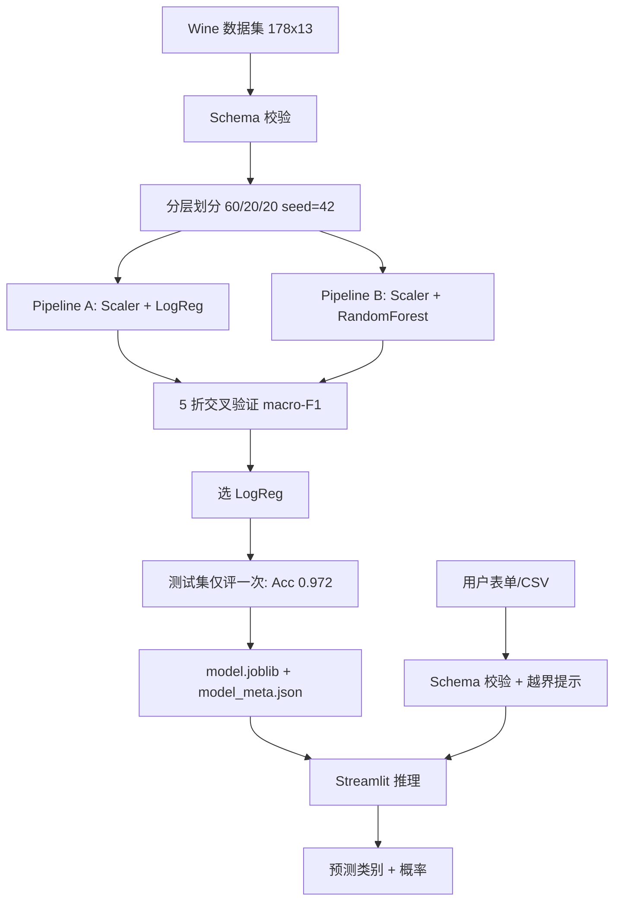

# Wine 品种智能分类器（实验四）

基于 **scikit-learn 1.9.1** + **Streamlit 1.66.0** 的红酒品种三分类应用。
用户输入 13 项理化指标，模型实时预测红酒属于哪个品种，并显示分类概率与越界提示。

## 目标用户与场景
葡萄酒生产/质检实验室中，化验员拿到气相色谱等化验值后，需要快速预判红酒品种。
本应用把训练好的 Pipeline 封装成本地 Web 表单，**不依赖 Notebook**。

## 技术栈与系统架构
- Python 3.14（CPU 推理，无需 GPU）
- scikit-learn：Pipeline（StandardScaler + 分类器）、交叉验证、指标
- Streamlit：表单推理 UI，`st.cache_resource` 加载模型
- pytest：22 项单元/集成测试



## 环境检查与安装
```powershell
python --version          # 3.14
python -m pip install -r requirements.txt
```

## 训练、运行、测试
```powershell
# 1. 训练（重新生成 models/model.joblib 与 model_meta.json）
python -m src.train

# 2. 启动 Web 推理界面
streamlit run app.py

# 3. 跑测试
python -m pytest -q
```

## 最小 Demo
启动后在"单条预测"标签页输入任意 13 项指标，点"预测"即出类别与概率；
"批量 CSV"标签页上传包含 13 列的 CSV，可下载整批预测结果。

## 测试结果
```
22 passed in 0.40s
```
覆盖：数据/划分 5 + 模型评价 2 + Pipeline 6 + 应用 6 + 自主功能 3。

## 二次开发内容（与上游基线的差异）
本项目**不 fork** scikit-learn / Streamlit 完整仓库，而是以它们为依赖库自建应用：
- 自己实现 `src/features.py`：Schema 校验、分层划分、训练范围越界检查
- 自己实现 `src/train.py`：两模型同协议 5 折比较、测试集单次评价、joblib + meta 保存
- 自己实现 `app.py`：Streamlit 单条表单 + 批量 CSV 上传/下载
- 自主功能：**批量 CSV 预测与结果下载**（Issue 记录验收条件），并附带训练范围越界提示

## 个人开发记录
- 数据划分：stratified 60/20/20，random_state=42
- 模型选择：依据 train 5 折 macro-F1（LogReg 0.990 vs RF 0.982）
- 测试集单次结果：Accuracy 0.972，macro-F1 0.971，macro-Precision 0.978，macro-Recall 0.967
- 混淆矩阵：仅 1 个样本误分（class_2 → class_1）

## 上游与第三方来源
- scikit-learn：https://github.com/scikit-learn/scikit-learn （BSD-3-Clause）
- Streamlit：https://github.com/streamlit/streamlit （Apache-2.0）
- Wine 数据集：UCI Machine Learning Repository（CC BY 4.0），通过 `sklearn.datasets.load_wine` 离线加载

## 安全注意事项
- `joblib.load` 只加载本项目训练的 `models/model.joblib`，不接受用户上传的模型文件
- 模型仅用于课程演示，概率不代表事实确定性
- 上传 CSV 仅在本地内存处理，不上传服务器
